# 01 — Producto y alcance

## 1. Visión

**Listapp** es una libreta de compras que vive en el móvil del usuario. Sirve para tres momentos concretos:

1. **Antes:** preparar la lista con calma.
2. **Durante:** marcar lo que ya se ha cogido, con una mano y sin perder tiempo.
3. **Después:** recordar qué se compró, cuándo y en qué supermercado.

La app es local, rápida y predecible. No pretende ser una red social, un comparador de precios ni un sistema de gestión del hogar.

## 2. Job to be done

> **Cuando** estoy en el supermercado con una mano ocupada y prisa, **quiero** marcar rápido lo que ya cogí y saber qué me falta, **para** terminar la compra y poder recordar después dónde y cuándo la hice.

### Persona principal

- Una persona que compra para su hogar, sola o en familia.
- Usa el móvil Android, muchas veces con una mano.
- No quiere configurar cuentas ni aprender una herramienta compleja.
- Valora no perder la lista y no tener que recordar la compra de memoria.
- Puede estar en un supermercado con mala cobertura: la app debe funcionar sin red.

### Pain points que resuelve

| Dolor | Respuesta de Listapp |
|---|---|
| La lista se pierde o se queda en casa. | Persistencia local y recuperación de la compra activa. |
| Marcar con prisa es incómodo. | Filas grandes, checkbox de 48 dp y háptico ligero. |
| No se sabe qué falta. | Progreso “7 de 12” siempre visible. |
| Se olvida dónde y cuándo se compró. | Historial con fecha, hora y supermercado. |
| Las apps de listas obligan a registrarse. | Sin login, sin nube, sin fricción. |
| El historial se mezcla con listas pendientes. | Separación clara entre Listas e Historial. |

## 3. Principios de producto

1. **Rapidez antes que decorate.** La acción principal debe estar a un toque.
2. **Una sola fuente de verdad.** Lo que se ve es lo que está guardado en SQLite.
3. **Sin sorpresas.** Finalizar, cancelar y borrar explican qué va a pasar.
4. **Offline por defecto.** Ninguna función depende de la red.
5. **Datos del usuario, en el dispositivo.** Sin analítica, sin cuentas, sin permisos innecesarios.
6. **Accesible desde el primer día.** No se deja para el final.
7. **Alcance pequeño y terminado.** Mejor un MVP sólido que una app a medias.

## 4. Alcance del MVP

### 4.1 Incluido

| Capacidad | Comportamiento |
|---|---|
| Crear lista | Nombre obligatorio de 1 a 80 caracteres tras `trim`. Se crea en estado `draft`. |
| Renombrar lista | Edición inline del nombre en el detalle, solo en `draft` o `shopping`. |
| Eliminar lista | Confirmación; borra la lista y sus artículos en cascada. |
| Añadir artículo | Nombre obligatorio de 1 a 100 caracteres tras `trim`. |
| Editar artículo | Cambiar el nombre; se conserva su posición. |
| Eliminar artículo | Con “Deshacer” de 5 segundos; solo el último borrado es deshacible. |
| Empezar compra | Requiere al menos un artículo y que no haya otra compra activa. Pasa a `shopping`. |
| Marcar/desmarcar | En modo compra; se guarda al instante; no se reordenan las filas. |
| Añadir durante la compra | El usuario puede añadir un artículo olvidado; se añade al final. |
| Progreso | Contador “X de Y” y barra; se actualiza al marcar. |
| Recuperar compra | Si se cierra la app, al abrir aparece “Continuar compra” con los checks guardados. |
| Cancelar compra | Confirmación; desmarca todo y vuelve a `draft`. |
| Finalizar compra | Requiere supermercado. Si hay 0 marcados, pide confirmación explícita. Guarda fecha/hora y supermercado en una transacción. |
| Historial | Lista de compras completadas, agrupadas por mes, orden descendente, con fecha completa, hora, supermercado y conteo. |
| Detalle histórico | Todos los artículos separados en “Comprados” y “Sin comprar”; solo lectura. |
| Eliminar compra | Confirmación; borra la compra y sus artículos. |
| Offline | Todo el flujo funciona en modo avión. |
| Identidad | Verde y blanco, tema claro, español, Android vertical. |
| Entrega | APK instalable generado con EAS Build. |

### 4.2 Fuera de alcance (v1.1 o nunca)

- Login, cuentas, nube, sincronización, multiusuario y colaboración.
- Precios, totales, presupuestos, ofertas y comparación de precios.
- Cantidades y unidades estructuradas (`2 kg`, `3 unidades`). El nombre del artículo puede incluir la cantidad como texto.
- Categorías, notas por artículo y orden manual por arrastre.
- Código de barras, OCR, voz, recetas e importación de listas.
- Catálogo de supermercados, geolocalización e historial de precios.
- Recordatorios, notificaciones, compartir y widgets.
- Modo oscuro, tablet, landscape y validación en iOS.
- Export/import, backup propio, búsqueda y filtros de historial.
- Listas recurrentes, plantillas, duplicar una compra y “repetir lista”.
- Cifrado SQLCipher, analítica, crash reporting y OTA updates.
- Publicación en Play Store; el entregable es un APK.

**Regla de control:** cualquier función que no sea necesaria para crear una lista, comprarla, finalizarla y consultarla queda fuera del MVP.

### 4.3 Decisiones de alcance que conviene conocer

| Decisión | Elección | Motivo |
|---|---|---|
| ¿Una compra activa o varias? | **Una sola** | Recuperación inequívoca y una portada simple. Se puede quitar el índice único en una migración futura. |
| ¿El supermercado es catálogo? | **Texto libre con sugerencias** | No hay que mantener un catálogo ni una base de tiendas. |
| ¿Se guardan artículos no comprados? | **Sí, como “Sin comprar”** | El historial refleja la lista real, no solo lo marcado. |
| ¿Se puede finalizar con 0 marcados? | **Sí, con confirmación** | Evita atrapar al usuario que olvidó marcar; deja constancia. |
| ¿Se puede editar una compra completada? | **No** | El historial es inmutable; solo se elimina. |
| ¿Se puede borrar el último artículo en compra? | **No** | Evita una compra vacía; para vaciar, se cancela y se edita el borrador. |
| ¿Historial paginado? | **No en el MVP** | Se carga todo y se virtualiza con `SectionList`; se añadirá si el volumen lo exige. |
| ¿Backup? | **No en el MVP** | `allowBackup=false`; export JSON en v1.1. Desinstalar borra los datos. |
| ¿Modo oscuro? | **No en el MVP** | Tema claro verde/blanco; los tokens quedan preparados. |

## 5. Ciclo de vida de una lista

```mermaid
stateDiagram-v2
  [*] --> draft: crear lista
  draft --> shopping: empezar compra (≥1 artículo, sin otra compra activa)
  shopping --> draft: cancelar compra (confirmar; desmarca todo)
  shopping --> completed: finalizar compra (supermercado; transacción)
  completed --> [*]: eliminar compra (confirmar)
  draft --> [*]: eliminar lista (confirmar)
  shopping --> [*]: eliminar lista (confirmar)
```



- `draft` y `shopping` son editables.
- `completed` es inmutable en contenido; solo se puede eliminar.
- Una lista `completed` no vuelve a `draft`. Para repetir una compra, v1.1 ofrecerá “Duplicar lista”.

## 6. Flujo principal

```text
Listas
  └─ Nueva lista
       └─ Detalle de lista
            ├─ Añadir / editar / eliminar artículos
            └─ Empezar compra
                 └─ Modo compra
                      ├─ Marcar / desmarcar
                      ├─ Añadir artículo
                      ├─ Salir y continuar después
                      └─ Finalizar compra
                           ├─ Elegir supermercado
                           ├─ Confirmar (0 marcados → confirmación extra)
                           └─ Historial → Detalle de compra
```

## 7. Criterios de aceptación

Cada criterio indica cómo se verifica. “Componente” = React Native Testing Library; “integración” = Jest + `node:sqlite`; “E2E” = Maestro; “manual” = checklist en dispositivo.

| ID | Criterio | Verificación |
|---|---|---|
| AC-01 | Crear una lista con nombre de 1–80 caracteres tras `trim`; queda en `draft`, aparece en Listas y sobrevive a cerrar y abrir la app. | Unitaria + integración + E2E |
| AC-02 | Renombrar una lista actualiza el nombre en Listas y en el detalle. Eliminar una lista pide confirmación y borra sus artículos en cascada. | Integración + E2E |
| AC-03 | Añadir un artículo vacío o solo espacios se rechaza con mensaje inline. Un nombre de 1–100 caracteres se guarda. Editar y eliminar persisten tras reiniciar. | Unitaria + integración + E2E |
| AC-04 | “Empezar compra” exige al menos un artículo, cambia a `shopping` y rechaza una segunda compra activa ofreciendo continuar la existente. | Integración + E2E |
| AC-05 | En modo compra, tocar un artículo alterna su estado de forma absoluta y persistente; el progreso se actualiza; las filas no se reordenan. | Integración + componente + E2E |
| AC-06 | Finalizar exige supermercado de 1–80 tras `trim`. Con ≥1 marcado confirma directamente; con 0 marcados pide confirmación explícita. La transacción relee estado, cuenta marcados y valida supermercado; el `UPDATE` condicionado evita finalizar dos veces; un doble toque no duplica ni muestra error tras navegar. | Integración + componente + E2E |
| AC-07 | Al finalizar, la lista desaparece de Listas y aparece en Historial, ordenada por fecha descendente. | E2E |
| AC-08 | Cada fila del historial muestra día, mes, año y hora (“27 oct 2026 · 18:42”), supermercado y “8 de 10 comprados”; se agrupa por mes (“octubre 2026”); sin paginación en el MVP. | E2E + integración con 300 filas + manual |
| AC-09 | El detalle histórico muestra todos los artículos, separados en “Comprados” y “Sin comprar”; no permite editar. | E2E |
| AC-10 | Eliminar una compra pide confirmación, borra la lista y sus artículos, y actualiza el historial. | E2E |
| AC-11 | Con la app cerrada a mitad de compra, al abrir aparece “Continuar compra” y los checks coinciden. Si el proceso muere durante una escritura, al reabrir la lista está `shopping` o `completed`, nunca a medias. | E2E `killApp`/`launchApp` + integración de rollback |
| AC-12 | En modo avión se puede crear lista, añadir artículos, comprar, finalizar y consultar historial sin errores de red. | Manual + revisión de código |
| AC-13 | Accesibilidad: cada artículo expone rol checkbox, estado comprado/no comprado y etiqueta; el progreso expone valor accesible; los errores se anuncian (RNTL). En dispositivo: objetivos ≥48 dp, texto al 200 % sin recortes, TalkBack comprensible y “reducir movimiento” respetado (manual). | Componente + manual |
| AC-14 | En el dispositivo documentado y APK `preview` release: mediana de 5 arranques en frío ≤2 s con `adb shell am start -W`; mediana de 20 checks en lista de 200 artículos: toque→commit ≤50 ms y toque→fila actualizada ≤100 ms, medido con instrumentación `performance.now()` y logcat; scroll sin tirones perceptibles. | Manual + `adb` + instrumentación |
| AC-15 | El APK de EAS `preview` se instala en un dispositivo físico, abre sin crash y completa el flujo entero. | Manual |
| AC-16 | El runner aplica la migración v1 sobre una BD vacía; una segunda ejecución es no-op y deja `user_version=1`. Una migración de prueba con fallo inyectado hace rollback: datos y versión intactos. Una BD con `user_version=2` no arranca: pantalla bloqueante con versión detectada e instrucciones, sin borrar la BD. | Integración |
| AC-17 | Tres inserciones con el mismo `created_at` fijo conservan el orden de inserción; borrar el artículo del medio no reordena el resto; el orden visual es `sort_order ASC`. | Integración |
| AC-18 | `/compra/[id]` solo admite `completed`; `/lista/[id]/comprar` y `/lista/[id]/finalizar` solo `shopping`; `/lista/[id]` con `completed` redirige a la compra. Un id inexistente en cualquiera de las cuatro rutas redirige a `+not-found`, sin crash ni pantalla intermedia. | Componente + manual/deep link |
| AC-19 | Borrar un artículo muestra “Artículo eliminado · Deshacer” durante 5 s. Deshacer restaura nombre, estado y posición si está libre; si no, lo añade al final. Pasados 5 s o al salir de la pantalla, el borrado persiste. En compra no se puede borrar el último artículo. Si se finaliza con el snackbar abierto, deshacer falla sin escribir. | Componente + integración |
| AC-20 | Cancelar compra pide confirmación que dice que se desmarcarán todos y quedará borrador. Atrás en modo compra no cancela. | Integración + E2E |
| AC-21 | Contrato de BD: `PRAGMA foreign_keys=1` y `journal_mode=wal` verificados al arrancar; todas las operaciones pasan por la cola; una transacción fallida hace rollback; un fallo de `COMMIT` no deja la conexión envenenada; ninguna pantalla lee antes de que `boot()` termine. | Integración + manual |
| AC-22 | Guardas de mutación: marcar/desmarcar solo en `shopping`; crear/editar/borrar/deshacer solo en `draft` o `shopping`; cualquier intento sobre `completed` devuelve `LIST_COMPLETED` y no escribe. | Integración |

## 8. Métricas de éxito del MVP

- Se completa el flujo crear → comprar → finalizar → consultar sin instrucciones externas.
- El check se percibe inmediato y sobrevive a cerrar la app.
- Cero pérdidas de datos en los escenarios de rollback y cierre forzado.
- El APK se instala en un dispositivo físico y funciona en modo avión.
- TalkBack puede recorrer y marcar artículos sin ambigüedad.
- El historial muestra fecha, hora y supermercado de cada compra.

## 9. Supuestos

1. Un solo usuario y un solo dispositivo; no hay cuentas.
2. Android es la plataforma objetivo del APK; iOS no se valida.
3. Hay una cuenta de Expo/EAS disponible para compilar.
4. Hay un dispositivo Android físico (o emulador API 34) para probar.
5. El usuario acepta que desinstalar la app borra los datos.
6. El idioma inicial es español; no hay selector de idioma.
7. El supermercado se escribe a mano; las sugerencias salen de compras anteriores.
8. La fecha/hora es la del dispositivo en el momento de confirmar.
9. “Local/offline” se refiere a la ejecución; EAS usa red durante el build.
10. No se promete cifrado de la base de datos; no hay datos sensibles declarados.
