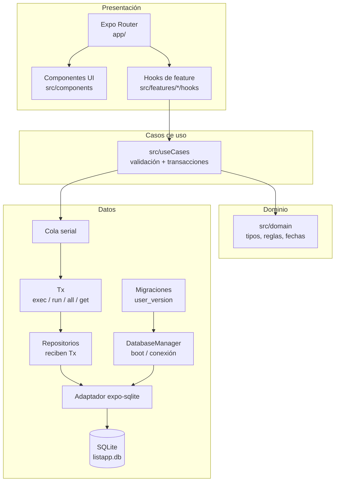

# 02 — Arquitectura

## 1. Resumen

Listapp es una app **local-first**: toda la información vive en SQLite, en el dispositivo. No hay servidor, autenticación ni sincronización. La arquitectura está pensada para que la app sea fácil de razonar, rápida en un móvil modesto y difícil de corromper.

La decisión central es:

> **Una sola conexión SQLite, una cola serial para todas las operaciones y transacciones explícitas. La UI nunca escribe SQL; los casos de uso son los únicos que abren transacciones.**

Alrededor de eso:

- **Expo Router** para navegación por archivos.
- **TypeScript estricto** en todas las capas.
- **Sin ORM**, **sin store global** y **sin librería de UI**.
- **Dos tablas**: `lists` e `items`.
- **Una lista completada es la compra histórica**; no hay una tabla `purchases` duplicada.
- **Una sola compra activa** a la vez, garantizada por la base de datos.
- **Sin red en ejecución**: ni analítica, ni recursos remotos, ni login.

## 2. Principios de arquitectura

| Principio | Consecuencia práctica |
|---|---|
| SQLite es la única fuente de verdad | No se cachean listas en un store global; se lee al enfocar y se actualiza localmente tras una escritura. |
| La UI es delgada | `app/` compone pantallas; los hooks y casos de uso hacen el trabajo. |
| El dominio es puro | Reglas, validaciones y formato de fechas sin React, Expo ni SQL. |
| Los datos están aislados | Solo `src/infrastructure` contiene SQL. |
| Las transacciones son explícitas | `BEGIN IMMEDIATE` / `COMMIT` / `ROLLBACK`; no se usan los helpers de transacción de Expo. |
| La consistencia es estructural | Todas las operaciones pasan por una cola serial; las lecturas de foco esperan a las escrituras pendientes. |
| Se evita la ceremonia | Sin ORM, sin Redux, sin TanStack Query, sin Reanimated, sin NativeWind. |
| La accesibilidad no es opcional | Objetivos de 48 dp, roles y estados accesibles desde los primeros componentes. |
| El APK llega pronto | El primer build de EAS se hace al cerrar M3, con el flujo principal ya funcional. |

## 3. Stack y decisiones técnicas

| Tema | Decisión | Alternativa descartada | Motivo |
|---|---|---|---|
| Framework | **Expo SDK 58** | React Native CLI puro | Expo da build, módulos nativos y EAS sin mantener Android Studio/Gradle. |
| Navegación | **Expo Router** | React Navigation puro | Rutas por archivo, deep links y typed routes con menos boilerplate. |
| Lenguaje | **TypeScript estricto** | JavaScript | Seguridad de tipos en dominio, datos y navegación. |
| Base de datos | **SQLite + `expo-sqlite`** | Drizzle, Prisma, WatermelonDB, Realm | Solo dos tablas y un escritor; un ORM añade codegen y capas que no resuelven nada aquí. |
| Acceso a datos | **Puerto SQL + repositorios + cola serial** | `SQLiteProvider` + helpers de transacción | Control explícito de transacciones, PRAGMAs y recuperación. |
| Estado | **Estado local de pantalla + SQLite** | Zustand, Redux, TanStack Query | No hay estado compartido complejo; la cola resuelve la coherencia temporal. |
| Estilo | **StyleSheet + tokens TypeScript** | NativeWind/Tailwind | Sin plugin de Babel ni runtime extra; control total de accesibilidad. |
| Animación | **`Animated` de React Native** | Reanimated, GSAP, Framer Motion, Lottie | Solo se animan transform/opacity; Reanimated añadiría Worklets y configuración nativa. |
| Fuente | **Fuente del sistema** | Inter/Poppins/Manrope custom | Sin parpadeo, sin peso extra, respeta Dynamic Type. |
| Iconos | **`@expo/vector-icons` (Ionicons)** | Librería SVG adicional | Ya viene con Expo; sin assets remotos. |
| Fechas | **Formateador propio en español** | `Intl`, date-fns, dayjs | Evita diferencias de ICU entre Node y Android; los componentes locales ya están guardados. |
| Pruebas | **Jest + RNTL + `node:sqlite` + Maestro** | Detox | Maestro es suficiente para dos flujos y funciona sobre el APK. |
| Build | **EAS Build en la nube** | Gradle local | Java 8 local no sirve; EAS evita mantener JDK/Android SDK. |
| Distribución | **APK `preview` interno** | AAB/Play Store | El requisito es un APK instalable. |

## 4. Capas y dependencias



**Regla de dependencia:** Presentación → Casos de uso → Dominio. Datos implementa el puerto que usan los casos de uso. El dominio no importa React, Expo ni SQL. La UI nunca importa el `DatabaseManager` ni escribe SQL.

### 4.1 Responsabilidades por capa

| Capa | Responsabilidad | No hace |
|---|---|---|
| `app/` | Rutas, layouts, composición de pantallas, guardas de navegación. | SQL, transacciones, reglas de negocio. |
| `src/components` | Componentes visuales reutilizables y accesibles. | Acceso a datos. |
| `src/features/*/hooks` | Estado de pantalla, carga al enfocar, llamada a casos de uso. | SQL directo. |
| `src/useCases` | Validación, coordinación, transacciones, captura de hora, errores tipados. | JSX, navegación, estilos. |
| `src/domain` | Tipos, estados, reglas puras, validadores, progreso, formato de fechas. | Efectos secundarios, React, SQL. |
| `src/infrastructure` | Conexión, PRAGMAs, migraciones, cola, repositorios, mapeo de filas. | Reglas de UI. |
| `src/lib` | `Clock`, generador de IDs, errores, hápticos, instrumentación. | Lógica de negocio. |
| `src/theme` | Tokens de color, tipografía, espaciado, radios. | Componentes. |
| `src/strings` | Todos los textos visibles en español. | Lógica. |

## 5. Estructura de carpetas

```text
listapp/
  app/
    _layout.tsx                  # Boot gate + Stack raíz + error boundary
    (tabs)/
      _layout.tsx                # Tabs Listas / Historial
      index.tsx                  # Listas
      historial.tsx              # Historial
    lista/
      nueva.tsx                  # Modal crear lista
      [id]/
        index.tsx                # Detalle/edición de lista
        comprar.tsx              # Modo compra
        finalizar.tsx            # Modal finalizar compra
    compra/
      [id].tsx                   # Detalle de compra histórica
    +not-found.tsx
  src/
    components/
      ui/                        # Screen, Button, TextField, ProgressBar,
                                 # EmptyState, Snackbar, CheckboxRow
      listas/                    # ListCard, ItemRow, SupermarketInput
      historial/                 # PurchaseRow, MonthHeader
    features/
      listas/hooks/              # useLists, useListDetail, useShopping
      historial/hooks/           # useHistory, usePurchaseDetail
    useCases/                    # lists, shopping, history
    domain/                      # list, item, purchase, lifecycle,
                                 # validation, progress, date
    infrastructure/              # Todo el acceso a SQLite y al almacenamiento local
      databaseManager.ts         # open / boot / close / estado
      serialQueue.ts             # cola única
      sqlDatabase.ts             # puerto: exec, run, all, get, transaction
      expoSqliteAdapter.ts       # implementación de producción
      migrations/001_initial.ts
      repositories/              # listsRepository, itemsRepository
    theme/                       # tokens, typography
    strings/es.ts                # textos visibles
    lib/                         # clock, ids, errors, haptics, perf
  tests/
    unit/
    integration/
    component/
    fixtures/
  e2e/
    01-flujo-principal.yaml
    02-recuperacion.yaml
  assets/
  app.json
  eas.json
  tsconfig.json
  package.json
```

**Reglas:**

- `app/` solo compone; no contiene SQL ni lógica de negocio.
- `src/infrastructure` es el único lugar con SQL; el resto de la app consume casos de uso.
- Los repositorios reciben un `Tx`; no guardan una conexión global.
- Los casos de uso son los únicos que llaman a `read`/`mutate`.
- Se usa el alias `@/*` para imports absolutos.
- Los tests de integración usan un adaptador `node:sqlite`; los de producción, `expo-sqlite`.

## 6. Arranque y flujo de datos

### 6.1 Arranque (`boot`)

1. La pantalla nativa de splash permanece visible.
2. El layout raíz llama a `boot()` una sola vez. Llamadas concurrentes comparten la misma promesa.
3. `boot()` se ejecuta **dentro de la cola serial**:
   - abre la base de datos (`listapp.db`);
   - aplica PRAGMAs;
   - verifica `foreign_keys` = 1 y `journal_mode` = `wal`;
   - lee `PRAGMA user_version`;
   - si la versión es mayor que la conocida, bloquea con `SCHEMA_TOO_NEW`;
   - si es 0 y ya existen tablas, bloquea con `UNKNOWN_SCHEMA`;
   - si es 0 y la BD está vacía, aplica la migración v1;
   - verifica la versión final.
4. Solo cuando `boot()` termina correctamente se renderizan las rutas y se oculta el splash.
5. Cada guarda de ruta también espera a `boot()` (no-op si ya está listo). Un deep link en frío no puede leer antes de que la BD esté verificada.

**Si `boot()` falla:**

| Fallo | Comportamiento |
|---|---|
| `MIGRATION_FAILED`, `DB_CONFIG`, `DB_TIMEOUT` | Pantalla de error con “Reintentar”. Se cierra la conexión best-effort y se repite el boot completo. |
| `SCHEMA_TOO_NEW` | Pantalla “Versión no compatible” con versión detectada e instrucciones para instalar el APK más reciente. Sin reintento en bucle. |
| `DB_BROKEN` | Pantalla bloqueante con instrucciones para cerrar y volver a abrir la app. No se borra la BD. |

### 6.2 Lectura

1. La pantalla se monta o recibe foco.
2. El hook de feature llama a un caso de uso de lectura.
3. La lectura entra en la cola serial.
4. El repositorio recibe un `Tx` y ejecuta la consulta.
5. El hook mapea a tipos de dominio y actualiza el estado local de la pantalla.

Las lecturas también pasan por la cola. Esto es deliberado: una lectura de foco se encola **después** de las escrituras pendientes y, por tanto, ve el último `COMMIT`, no un estado anterior.

### 6.3 Escritura

1. El usuario actúa.
2. El hook llama al caso de uso.
3. El caso de uso abre una transacción (`BEGIN IMMEDIATE`).
4. El repositorio recibe el `Tx` y ejecuta la mutación.
5. Se hace `COMMIT`.
6. El caso de uso devuelve el resultado (por ejemplo, el ítem actualizado y el nuevo progreso).
7. El hook actualiza **solo** el estado afectado: el ítem y el contador. No se relee toda la lista.
8. Si falla, se hace `ROLLBACK` y la UI no cambia; se muestra un mensaje y se ofrece reintentar.

No hay escritura optimista. La escritura se confirma antes de reflejarse. Las operaciones son pequeñas y locales; el retardo es imperceptible y se gana certeza de persistencia.

### 6.4 Consistencia entre pantallas

**No hay store global ni contador de revisión.** La coherencia se consigue con tres reglas:

1. Todas las operaciones pasan por la misma cola serial.
2. Las lecturas de foco se encolan detrás de las escrituras pendientes.
3. Cada pantalla actualiza su estado local tras una mutación y vuelve a leer al recuperar el foco.

Ejemplo: el usuario marca “Leche” y pulsa atrás inmediatamente. La escritura ya está en la cola; la lectura de la portada se encola después y espera al `COMMIT`. La portada muestra el progreso correcto. No hace falta un store que notifique a todas las pantallas.

La única excepción sería una pantalla visible que deba reaccionar a una mutación hecha en otra pantalla sin perder el foco. En este MVP no ocurre: los modales tapan la pantalla anterior y, al cerrarse, esta recupera el foco y relee. Si en el futuro se añade colaboración o varias ventanas, se reconsiderará un store.

### 6.5 Actualización de una fila de artículo

Para evitar re-renderizar 200 filas por un check:

- El caso de uso devuelve el ítem actualizado y el progreso.
- El hook reemplaza **solo** ese ítem en el array y actualiza el contador.
- `ItemRow` está memorizado y recibe su ítem; solo la fila cambiada se vuelve a renderizar.
- No se hace una lectura completa después de cada check.

## 7. Contrato de transacción y cola

### 7.1 Una conexión, una cola

- Hay **una sola conexión** a SQLite, gestionada por `DatabaseManager`.
- **Todas** las operaciones (lecturas y escrituras) pasan por `serialQueue`.
- La cola es una cadena de promesas: cada tarea espera a la anterior. Un fallo no rompe la cola.
- No se usan `withTransactionAsync()` ni `withExclusiveTransactionAsync()`:
  - el primero no es exclusivo y permite que consultas ajenas entren en la transacción;
  - el segundo abre otra conexión y no copia los PRAGMAs, con lo que `foreign_keys` puede quedar desactivado y romper la cascada.

### 7.2 Transacción de escritura

Toda mutación, incluso la de una sola fila, sigue este contrato:

1. Entra en la cola.
2. Ejecuta `BEGIN IMMEDIATE`.
3. El caso de uso recibe un `Tx` y llama a repositorios que solo conocen ese `Tx`.
4. Ejecuta la mutación.
5. Ejecuta `COMMIT`.
6. Sale de la cola.

Si algo falla:

1. Intenta `ROLLBACK`.
2. **No silencia** el error del rollback: lo registra y lo adjunta al error original.
3. Hace una sonda: `BEGIN IMMEDIATE` + `ROLLBACK`. Si la sonda funciona, la conexión está sana y se propaga el error de escritura.
4. Si la sonda falla, la conexión se marca como `DB_BROKEN`: se cierra, se bloquea la app y se pide reiniciar. No se reutiliza una conexión en estado desconocido.

### 7.3 Reglas de reentrada

- Los repositorios **reciben un `Tx`**. No tienen acceso al `DatabaseManager` ni a la cola.
- Los casos de uso son los únicos que llaman a `read`/`mutate`; dentro de una transacción solo usan el `Tx`.
- No se anidan transacciones. Una transacción dentro de otra es un error de diseño.
- Una regla de lint (`no-restricted-imports`) impide que `useCases` y `repositories` importen el `DatabaseManager`.
- La prevención es estructural (tipos + imports), no un flag global que podría rechazar lecturas externas legítimas mientras una tarea está en curso.

### 7.4 PRAGMAs y verificación

Al abrir la conexión, fuera de cualquier transacción:

| PRAGMA | Valor | Verificación |
|---|---|---|
| `foreign_keys` | `ON` | Debe devolver `1`; si no, `DB_CONFIG`. |
| `journal_mode` | `WAL` | Debe devolver `wal`; si no, `DB_CONFIG`. |
| `busy_timeout` | `5000` ms | Se aplica; no se verifica con una aserción estricta. |
| `synchronous` | `NORMAL` | Adecuado para WAL y una app local. |

`foreign_keys` es **por conexión**. No se asume que el build de Expo lo active por defecto.

### 7.5 Watchdog de sesión

- Cada tarea de la cola tiene un watchdog de **10 segundos**.
- Si se supera, la sesión se marca como no fiable, se muestra una pantalla bloqueante y se pide cerrar y volver a abrir la app.
- El watchdog **no libera la cola ni reutiliza la conexión** mientras la tarea anterior pueda seguir viva. Esto evita escrituras sobre un handle obsoleto.
- En la práctica las operaciones son de milisegundos; el watchdog es una red de seguridad, no el camino normal.

### 7.6 Recuperación de `COMMIT`

- Si `COMMIT` falla, se intenta `ROLLBACK` y se hace la sonda descrita.
- Si la sonda pasa, se propaga `DB_WRITE_FAILED` y la app sigue; la UI permite reintentar.
- Si la sonda falla, `DB_BROKEN`: pantalla bloqueante con instrucciones.
- No se reabre automáticamente la conexión en v1. Reabrir mientras una tarea antigua puede seguir viva es más arriesgado que pedir un reinicio. Al siguiente arranque, `boot()` abre una conexión limpia.

## 8. Modelo de errores

Los casos de uso lanzan `AppError` con un código estable. La UI traduce el código a un mensaje en español; nunca muestra un error crudo de SQLite.

| Código | Significado | Respuesta de UI |
|---|---|---|
| `VALIDATION` | Nombre vacío, supermercado inválido, longitud. | Mensaje inline junto al campo. |
| `NOT_FOUND` | Lista o artículo inexistente. | Redirección segura o `+not-found`. |
| `INVALID_STATE` | Acción no permitida para el estado actual. | Mensaje y recarga de la pantalla. |
| `LIST_COMPLETED` | Se intentó mutar una compra completada. | “La compra ya está finalizada”; recarga. |
| `ACTIVE_SHOPPING_EXISTS` | Ya hay otra compra activa. | Ofrecer “Continuar compra”. |
| `LAST_ITEM_IN_SHOPPING` | Se intentó borrar el último artículo en compra. | “Cancela la compra para vaciar la lista”. |
| `NO_CHECKED` | Se intentó finalizar con 0 marcados sin confirmar. | Pedir confirmación explícita. |
| `EMPTY_LIST` | Se intentó empezar o finalizar una lista vacía. | Deshabilitar la acción con ayuda contextual. |
| `DB_BUSY` | SQLite ocupado. | Reintentar. |
| `DB_WRITE_FAILED` | Fallo de escritura con conexión sana. | “No se pudo guardar. Reintenta”. |
| `DB_TIMEOUT` | Watchdog agotado. | Pantalla de reinicio. |
| `DB_BROKEN` | Conexión no fiable. | Pantalla bloqueante con instrucciones. |
| `SCHEMA_TOO_NEW` | BD de una versión posterior. | Pantalla “Versión no compatible”. |
| `MIGRATION_FAILED` | Migración fallida. | “Reintentar”; nunca borrar la BD. |
| `UNKNOWN_SCHEMA` | `user_version=0` con tablas existentes. | Pantalla de error; no tocar la BD. |

## 9. Dependencias

### 9.1 Producción

| Dependencia | Uso |
|---|---|
| `expo` (SDK 58), `react`, `react-native` | Base de la app. |
| `expo-router` | Navegación y rutas tipadas. |
| `expo-linking`, `expo-constants` | Requeridas por Expo Router. |
| `expo-sqlite` | Persistencia local. |
| `expo-crypto` | UUID v4 para listas e ítems. |
| `expo-haptics` | Feedback ligero al marcar y al finalizar. |
| `expo-splash-screen` | Splash nativo hasta que `boot()` termina. |
| `expo-status-bar` | Barra de estado coherente con el tema claro. |
| `@expo/vector-icons` | Iconos Ionicons. |
| `react-native-screens` | Pantallas nativas del stack. |
| `react-native-safe-area-context` | Safe areas y edge-to-edge. |
| `react-native-gesture-handler` | Parte del stack de navegación; no se usa directamente para gestos propios. |

Las versiones se fijan con `npx expo install` para que coincidan con SDK 58. Las versiones del template instalado son React Native 0.88.0, React 19.3.0 y TypeScript 6.0.3. No se inventan versiones de terceros.

### 9.2 Desarrollo

| Dependencia | Uso |
|---|---|
| `typescript`, `@types/react`, `@types/jest` | Tipado. |
| `@types/node` | Tipos de `node:sqlite` en tests. |
| `eslint`, `eslint-config-expo` | Lint, incluida la regla de imports. |
| `jest`, `jest-expo` | Unitarias, integración y componentes. |
| `@testing-library/react-native` | Pruebas de componentes. |
| `node:sqlite` (incluido en Node 24) | Adaptador de integración; sin dependencia nativa. |
| Maestro CLI (externo) | E2E sobre el APK. |
| EAS CLI (vía `npx`) | Build en la nube. |

### 9.3 Excluidas y por qué

| Dependencia | Por qué no |
|---|---|
| Reanimated / Worklets | Solo se animan transform/opacity; `Animated` de RN basta y evita configuración nativa. |
| Drizzle / Prisma | Codegen y capa extra para dos tablas. |
| WatermelonDB / Realm | Pensados para sincronización y volúmenes grandes. |
| Zustand / Redux | No hay estado global compartido. |
| TanStack Query | Cachea datos remotos; aquí la fuente es local. |
| NativeWind / Tailwind | Plugin y runtime extra; los tokens de StyleSheet son suficientes. |
| Librería de UI (Paper, UI Kitten) | Se necesita una identidad propia y ~10 componentes. |
| date-fns / dayjs | El formato es pequeño y se guardan componentes locales. |
| i18n | Solo español; un archivo de strings es suficiente. |
| SQLCipher | No hay datos sensibles declarados. |
| Sentry / analítica | Privacidad y offline; no se pide telemetría. |
| `expo-updates` / OTA | No se necesita actualización en caliente; el APK se reinstala. |

## 10. Configuración de Expo Router y app

| Clave | Valor |
|---|---|
| `name` | Listapp |
| `slug` | listapp |
| `scheme` | listapp |
| `version` | 1.0.0 |
| `orientation` | `portrait` |
| `userInterfaceStyle` | `light` |
| `android.package` | `com.jeanx.listapp` (confirmado; D-01) |
| `android.versionCode` | 1 |
| `android.allowBackup` | `false` |
| `plugins` | `expo-router`, `expo-splash-screen` |
| `experiments.typedRoutes` | `true` |
| `newArchEnabled` | No se configura; SDK 58 usa la nueva arquitectura. |
| Icono / splash | Fondo verde, símbolo blanco de cesta con check; adaptativo y monocromo. |

El layout raíz:

- mantiene el splash hasta que `boot()` termina;
- muestra una pantalla de error si `boot()` falla;
- monta el `Stack` raíz con las tabs y las rutas modales;
- define un error boundary de ruta.

No se usa `SQLiteProvider`: el ciclo de vida lo controla `DatabaseManager`, para poder hacer boot gate y cerrar la conexión en caso de error.

## 11. Entorno y compilación

### 11.1 Entorno local

| Herramienta | Estado / decisión |
|---|---|
| Node | **24.22.1** fijado en `.nvmrc` y `engines` (`>=24.22.1 <25`). |
| `node:sqlite` | Verificado en Node 24.22.1: exporta `DatabaseSync`; `Database` no existe. Se usa `DatabaseSync` en tests. |
| Java | **JDK 17+** para Maestro. El Java 8 local no sirve para Android. |
| Android | `platform-tools` (`adb`) y un dispositivo físico Android 13+ (API 33/34) o emulador API 34. |
| EAS | Cuenta personal de Expo/EAS confirmada; keystore gestionado por EAS (D-02). |
| Git | Repositorio inicializado en GitHub (`JuanReyesVazquez23/Listapp`), rama `main`. |

**Camino principal:** EAS Build en la nube para el APK; dispositivo físico para instalar y probar; JDK 17 + `platform-tools` para Maestro y `adb`.

**Fallback local:** JDK 17 + Android SDK, solo si EAS no está disponible. No es el camino recomendado.

### 11.2 Perfiles de build

| Perfil | Salida | Uso |
|---|---|---|
| `preview` | **APK**, distribución interna | Entrega e instalación directa. |
| `production` | AAB | Futuro Play Store; no solicitado ahora. |
| `development` | Development build | Depuración opcional; no es necesario para el MVP. |

Pasos:

1. `npx expo-doctor` y `npx expo install --check`.
2. `eas login`.
3. `eas build:configure`.
4. `eas build -p android --profile preview`.
5. Descargar el APK e instalar con `adb install -r`.
6. Smoke test del flujo completo.
7. Guardar el keystore y las credenciales de EAS.

El primer build se hace al cerrar **M3**, cuando ya existe el flujo completo de lista, compra e historial, para validar cuenta, credenciales, SDK, paquete y entorno sobre una app usable.

### 11.3 Android

- Android 7+ (API 24), `targetSdkVersion` 36 (el que fije SDK 58).
- Vertical, teléfono; no se optimiza tablet ni landscape.
- Edge-to-edge con safe areas.
- Sin permisos sensibles: ni ubicación, ni cámara, ni contactos, ni micrófono.
- `allowBackup=false`: coherente con “sin nube”, pero desinstalar borra los datos.
- No se bloquea el permiso `INTERNET` en v1; la app no hace peticiones en ejecución, pero Expo/Herramientas pueden usarlo. Se puede endurecer en el futuro.

## 12. Seguridad y privacidad

- **Sin red en ejecución:** no hay `fetch`, analítica, crash reporting ni recursos remotos.
- **Sin cuentas:** no se recogen datos personales.
- **SQL parametrizado:** los valores del usuario se pasan como parámetros; no se interpola texto en las consultas.
- **Validación en dominio y en BD:** longitudes, estados y consistencia de checks.
- **Base de datos no cifrada:** el contenido son listas de la compra; no se declaran datos sensibles. SQLCipher queda fuera del MVP.
- **Deep links:** las rutas validan el estado y el id; no exponen información sensible.
- **Backup del sistema desactivado:** `allowBackup=false`. La pérdida al desinstalar es un riesgo aceptado y documentado.
- **Export/import:** v1.1, en JSON o copia del archivo SQLite; no contradice el modo offline.

## 13. Riesgos y mitigaciones

| Riesgo | Impacto | Mitigación |
|---|---|---|
| El contrato de transacción no se ha probado en un dispositivo real. | Alto | Smoke test al generar el primer APK (M3); tests de integración con `node:sqlite`; prueba de cascada y rollback. |
| `expo-sqlite` puede comportarse distinto al cerrar/reabrir con WAL. | Medio | No se reabre en caliente en v1; se pide reiniciar. Probar el primer APK en dispositivo (M3). |
| Maestro en Windows requiere JDK 17 y `adb`; puede necesitar WSL2. | Medio | Documentar entorno; si falla, E2E manual y Maestro en WSL2. |
| Cuenta EAS confirmada; faltan keystore y primer build por verificar. | Alto | Verificar al cerrar M3, antes de la entrega del APK. |
| Pérdida de datos al desinstalar. | Medio | Aviso explícito; export JSON en v1.1. |
| Crecimiento del historial sin paginación. | Bajo | `SectionList` virtualiza; test con 300 filas; paginación en v1.1 si hace falta. |
| Texto ampliado o TalkBack rompen el layout. | Medio | 48 dp, sin alturas fijas, checklist manual y RNTL. |
| Reloj del dispositivo incorrecto. | Bajo | La fecha refleja el dispositivo; no hay servidor. Documentado. |
| Una tarea de BD se cuelga. | Bajo | Watchdog de 10 s y pantalla de reinicio; no se reutiliza la conexión. |
| Cambio de alcance. | Medio | Gate de MVP; todo lo demás a v1.1. |

## 14. Decisiones registradas (ADR resumido)

| ID | Decisión | Estado |
|---|---|---|
| A01 | SQLite local como única fuente de verdad; sin nube. | Aceptada |
| A02 | Dos tablas: `lists` e `items`; una compra es una lista `completed`. | Aceptada |
| A03 | Expo Router en lugar de React Navigation puro. | Aceptada |
| A04 | SQLite crudo + repositorios, sin ORM. | Aceptada |
| A05 | Sin store global; estado local + cola serial + relectura al enfocar. | Aceptada |
| A06 | Transacciones explícitas `BEGIN IMMEDIATE`/`COMMIT`/`ROLLBACK`; sin helpers de Expo. | Aceptada |
| A07 | `DatabaseManager` propio en lugar de `SQLiteProvider`. | Aceptada |
| A08 | Sin Reanimated; `Animated` de RN. | Aceptada |
| A09 | StyleSheet + tokens; sin NativeWind. | Aceptada |
| A10 | Fuente del sistema; sin fuentes custom. | Aceptada |
| A11 | Supermercado como texto libre con sugerencias. | Aceptada |
| A12 | Una sola compra activa, con índice único parcial. | Aceptada |
| A13 | Fecha/hora local + UTC; formateador español propio. | Aceptada |
| A14 | Historial sin paginación en el MVP. | Aceptada |
| A15 | Finalizar con 0 marcados permitido tras confirmación. | Aceptada |
| A16 | `allowBackup=false`; export en v1.1. | Aceptada con riesgo |
| A17 | Sin migración v2 ficticia; guarda de downgrade. | Aceptada |
| A18 | Deshacer borrado de artículo durante 5 s. | Aceptada |
