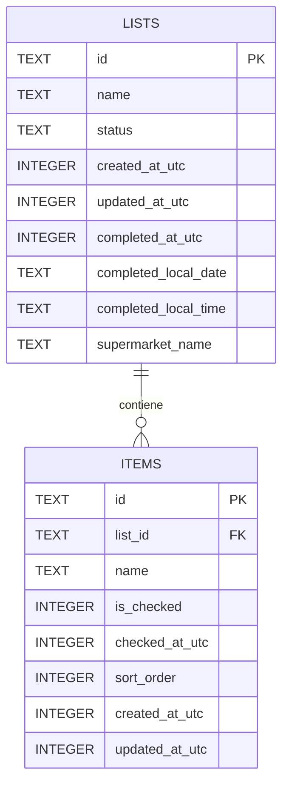
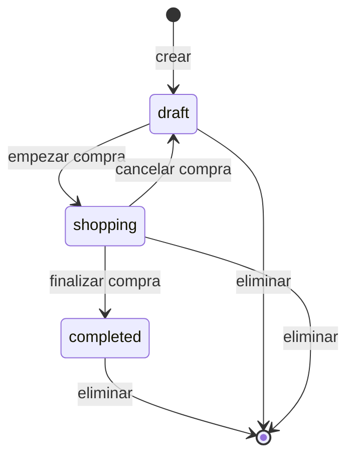

# 03 — Modelo de datos

## 1. Principios

1. **Dos tablas:** `lists` e `items`.
2. **Una compra completada es una lista con `status = 'completed'`.** No hay tabla `purchases` duplicada.
3. **Inmutabilidad:** una compra completada no se edita; solo se elimina.
4. **Historial con fecha y hora local:** se guardan componentes locales (`YYYY-MM-DD` y `HH:mm`) además de UTC para ordenar.
5. **Supermercado como texto libre**, no como catálogo.
6. **Una sola compra activa** a la vez, garantizada por un índice único parcial.
7. **Orden determinista** de artículos con `sort_order`, no por timestamp ni UUID.
8. **Migraciones forward-only** con `PRAGMA user_version`.

## 2. Relación entre entidades

- Una lista tiene cero o más artículos.
- Un artículo pertenece a una sola lista.
- Al borrar una lista se borran sus artículos (`ON DELETE CASCADE`).
- No hay tabla de supermercados, categorías, precios ni cantidades.

## 3. Tabla `lists`

| Campo | Tipo | Nulo | Regla |
|---|---|---|---|
| `id` | `TEXT` | No | UUID v4 generado en la app; clave primaria. |
| `name` | `TEXT` | No | `trim` entre 1 y 80 caracteres. |
| `status` | `TEXT` | No | `draft`, `shopping` o `completed`. Por defecto `draft`. |
| `created_at_utc` | `INTEGER` | No | Epoch en milisegundos UTC. |
| `updated_at_utc` | `INTEGER` | No | Epoch ms UTC; se actualiza al cambiar la lista o cualquiera de sus artículos. |
| `completed_at_utc` | `INTEGER` | Sí | Epoch ms UTC; solo si `completed`. |
| `completed_local_date` | `TEXT` | Sí | `YYYY-MM-DD` local del momento de finalizar; solo si `completed`. |
| `completed_local_time` | `TEXT` | Sí | `HH:mm` local; solo si `completed`. |
| `supermarket_name` | `TEXT` | Sí | `trim` entre 1 y 80; solo si `completed`. |

### 3.1 Invariante de cierre

- Si `status = 'completed'`:
  - `completed_at_utc`, `completed_local_date`, `completed_local_time` y `supermarket_name` son no nulos;
  - el supermercado tiene entre 1 y 80 caracteres tras `trim`.
- Si `status <> 'completed'`:
  - los cuatro campos de cierre son nulos.

La base de datos lo garantiza con una restricción `CHECK`; la app valida antes para dar un mensaje claro.

### 3.2 Nombres

- Se normalizan con `trim` en JavaScript antes de insertar o actualizar.
- No se aceptan cadenas vacías ni solo espacios.
- Los nombres de lista **no son únicos**: puede haber dos “Compra semanal”.
- Se conserva el texto original (mayúsculas, acentos) después de `trim`.

## 4. Tabla `items`

| Campo | Tipo | Nulo | Regla |
|---|---|---|---|
| `id` | `TEXT` | No | UUID v4; clave primaria. |
| `list_id` | `TEXT` | No | FK a `lists.id`; `ON DELETE CASCADE`. |
| `name` | `TEXT` | No | `trim` entre 1 y 100 caracteres. |
| `is_checked` | `INTEGER` | No | 0 o 1; por defecto 0. |
| `checked_at_utc` | `INTEGER` | Sí | Epoch ms UTC; no nulo si y solo si `is_checked = 1`. |
| `sort_order` | `INTEGER` | No | Entero positivo; único dentro de la lista. |
| `created_at_utc` | `INTEGER` | No | Epoch ms UTC; auditoría. |
| `updated_at_utc` | `INTEGER` | No | Epoch ms UTC; última modificación. |

### 4.1 Invariantes

1. `sort_order > 0`.
2. `(list_id, sort_order)` es único.
3. `is_checked = 1` implica `checked_at_utc` no nulo.
4. `is_checked = 0` implica `checked_at_utc` nulo.
5. Un artículo no existe sin lista.
6. Los artículos se ordenan por `sort_order ASC`; los empates no existen por el índice único.
7. No se renumera al borrar: los huecos son válidos.

### 4.2 Por qué `sort_order` y no `created_at`

Dos artículos añadidos en el mismo milisegundo tendrían el mismo `created_at`; ordenar por UUID sería aleatorio. Un cambio de reloj del dispositivo podría colocar un artículo nuevo antes de los antiguos. `sort_order` es determinista y no depende del reloj.

**Asignación:** al insertar, dentro de la misma transacción:

> `sort_order = (SELECT COALESCE(MAX(sort_order), 0) + 1 FROM items WHERE list_id = ?)`

No hay ventana entre el cálculo y el insert porque la transacción es `BEGIN IMMEDIATE` y la conexión es única.

**Borrado:** no se renumeran los demás. Un hueco no afecta al orden.

**Deshacer:** se intenta restaurar el `sort_order` original si está libre; si está ocupado, se usa `MAX + 1` (al final). La comprobación y el insert van en la misma transacción.

## 5. Índices y restricciones

| Nombre | Definición | Para qué |
|---|---|---|
| `idx_lists_active` | Índice parcial sobre `lists(status, updated_at_utc DESC)` donde `status IN ('draft','shopping')`. | Portada: compra activa y borradores. |
| `idx_lists_history` | Índice parcial sobre `lists(completed_at_utc DESC)` donde `status = 'completed'`. | Historial ordenado. |
| `ux_lists_single_shopping` | Índice único parcial sobre `lists(status)` donde `status = 'shopping'`. | Garantiza una sola compra activa. |
| `ux_items_list_sort` | Índice único sobre `items(list_id, sort_order)`. | Orden determinista y acceso por lista. |

No se indexa `supermarket_name`: el volumen es bajo y las sugerencias se obtienen de las últimas compras.

### 5.1 Restricciones de la base de datos

- `lists.status` solo admite los tres estados.
- `lists.name` y `items.name` tienen longitud válida tras `trim`.
- Cierre consistente de `lists`.
- `items.is_checked` solo 0 o 1.
- Consistencia entre `is_checked` y `checked_at_utc`.
- `items.sort_order > 0` y único por lista.
- FK con cascada.

La app valida además antes de escribir para dar mensajes de error útiles.

## 6. Ciclo de vida y transiciones

| Desde | Acción | Hasta | Guardas | Efectos |
|---|---|---|---|---|
| — | Crear lista | `draft` | Nombre 1–80 | Inserta `lists`; timestamps. |
| `draft` | Renombrar | `draft` | Nombre 1–80 | Actualiza `name` y `updated_at`. |
| `draft` | Añadir/editar/borrar artículo | `draft` | Nombre válido; no completada | Inserta/actualiza/borra; actualiza `updated_at` de la lista. |
| `draft` | Empezar compra | `shopping` | ≥1 artículo; ninguna otra compra activa | Cambia estado; actualiza `updated_at`. |
| `shopping` | Marcar/desmarcar | `shopping` | Artículo existe; lista en `shopping` | Actualiza `is_checked`, `checked_at`, `updated_at` del ítem y de la lista. |
| `shopping` | Añadir/editar/borrar artículo | `shopping` | Nombre válido; no completada; no borrar el último | Inserta/actualiza/borra; actualiza `updated_at` de la lista. |
| `shopping` | Cancelar compra | `draft` | Confirmación | Desmarca todos; limpia `checked_at`; actualiza `updated_at`. |
| `shopping` | Finalizar compra | `completed` | Supermercado válido; 0 marcados requiere confirmación; transacción | Escribe estado y campos de cierre; `updated_at`. |
| `completed` | Editar/renombrar/marcar/volver a borrador | — | — | Prohibido; `LIST_COMPLETED`. |
| `completed` | Eliminar compra | — | Confirmación | Borra la lista; cascada de artículos. |
| `draft`/`shopping` | Eliminar lista | — | Confirmación | Borra la lista; cascada de artículos. |

## 7. Mutaciones y guardas de estado

Todas las mutaciones de artículos se validan **dentro de la misma transacción**, no solo en la UI.

| Mutación | Guarda |
|---|---|
| Marcar/desmarcar | La lista debe estar en `shopping`. |
| Crear artículo | La lista debe estar en `draft` o `shopping` (`status <> 'completed'`). |
| Renombrar artículo | La lista debe estar en `draft` o `shopping`. |
| Borrar artículo | La lista debe estar en `draft` o `shopping`; en `shopping`, no puede ser el último. |
| Deshacer borrado | La lista debe estar en `draft` o `shopping`; si está `completed`, falla sin escribir. |
| Renombrar lista | La lista debe estar en `draft` o `shopping`. |
| Iniciar compra | La lista debe estar en `draft`, tener ≥1 artículo y no existir otra `shopping`. |
| Cancelar compra | La lista debe estar en `shopping`. |
| Finalizar | La lista debe estar en `shopping`; supermercado válido; 0 marcados requiere confirmación. |

La implementación usa una condición en la propia sentencia (`EXISTS` sobre el estado de la lista) y comprueba el número de filas afectadas. Si es 0, se relee dentro de la transacción para distinguir “no existe”, “estado incompatible” o “lista completada”.

### 7.1 Marcar/desmarcar es absoluto

La UI envía el estado deseado (`true`/`false`), no “alternar”. Así, un reintento tras un fallo no invierte dos veces el estado.

- Marcar: `is_checked = 1`, `checked_at_utc = ahora`.
- Desmarcar: `is_checked = 0`, `checked_at_utc = null`.

## 8. Finalizar compra

`finishPurchase` es el caso de uso más delicado. Se ejecuta completo dentro de una transacción:

1. Releer la lista por `id`.
2. Si no existe → `NOT_FOUND`.
3. Si ya está `completed` → **éxito idempotente**: no escribe, devuelve la compra. Un doble toque no duplica ni muestra error.
4. Si no está `shopping` → `INVALID_STATE`.
5. Contar artículos totales y marcados.
6. Si total = 0 → `EMPTY_LIST` (defensa; el flujo normal no lo permite).
7. Si marcados = 0 y no se confirmó explícitamente → `NO_CHECKED`. La UI pide confirmación “Se guardará con 0 comprados”.
8. Validar supermercado tras `trim` (1–80).
9. Capturar la hora con `Clock` (el momento de confirmar) y calcular fecha/hora local.
10. Ejecutar un `UPDATE` condicionado a que la lista siga en `shopping`.
11. Comprobar las filas afectadas: si 0, releer para distinguir “ya completada” de “estado inválido”.
12. `COMMIT`.

Si falla cualquier paso, `ROLLBACK`: no queda una compra a medias.

**Artículos no comprados:** se conservan con `is_checked = 0` y se muestran en el detalle histórico como “Sin comprar”. No se crea automáticamente una lista nueva en el MVP.

**Snackbar de deshacer:** si hay un borrado pendiente de deshacer, al finalizar con éxito se cancela el temporizador y se cierra el snackbar. Un “Deshacer” tardío intenta escribir y recibe `LIST_COMPLETED`; no modifica la compra.

## 9. Fechas y horas

### 9.1 Qué se guarda

| Dato | Formato | Uso |
|---|---|---|
| `completed_at_utc` | Epoch ms UTC | Ordenar el historial de forma inequívoca. |
| `completed_local_date` | `YYYY-MM-DD` | Mostrar día, mes y año; agrupar por mes. |
| `completed_local_time` | `HH:mm` | Mostrar la hora local de la compra. |

### 9.2 Por qué no un único ISO con offset

- Un ISO con offset puede ordenarse mal si cambia el offset.
- Al formatearlo con la zona horaria actual se puede desplazar la hora que el usuario recuerda.
- Guardar los componentes locales preserva la hora vivida aunque el usuario viaje o cambie de zona horaria.
- `completed_at_utc` sigue siendo la referencia para ordenar.

### 9.3 Formato visible

- Fila del historial: **“27 oct 2026 · 18:42”**.
- Detalle: **“martes, 27 de octubre de 2026, 18:42”**.
- Cabecera de grupo: **“octubre 2026”**.

Se usa un formateador propio con arrays de días y meses en español. No se usa `Intl` en la UI: evita diferencias de ICU entre Node y Android y hace los tests deterministas.

### 9.4 Captura

- La hora se captura al confirmar “Finalizar compra”, no al abrir el modal.
- Se usan los getters locales del dispositivo (`getFullYear`, `getMonth`, `getDate`, `getHours`, `getMinutes`) y se rellenan a dos dígitos.
- No se guardan segundos; el requisito es hora y minuto.
- Si el reloj del dispositivo está mal, la fecha registrada será la del dispositivo; no hay servidor que corrija.

## 10. Supermercado

- Campo de texto libre en `lists.supermarket_name`.
- Obligatorio solo al completar.
- Se normaliza con `trim`; se conserva el texto original para mostrar.
- Sugerencias: las últimas 8 compras, agrupadas sin distinguir mayúsculas/minúsculas, mostradas como chips encima del campo.
- No hay tabla `supermarkets` en el MVP.
- Si más adelante se quiere catálogo, geolocalización o estadísticas por tienda, se añade una tabla y una FK mediante migración; la UI cambia poco.

## 11. Migraciones

- Fuente de versión: `PRAGMA user_version`.
- Migraciones **forward-only**; nunca se edita una migración ya publicada.
- Cada migración se ejecuta dentro de una transacción; si falla, rollback y `user_version` queda intacto.
- Al arrancar:
  - si `user_version` es mayor que la última conocida → `SCHEMA_TOO_NEW`, pantalla bloqueante;
  - si es 0 y no hay tablas → aplicar v1;
  - si es 0 y hay tablas → `UNKNOWN_SCHEMA`, no tocar;
  - si es menor → aplicar las pendientes en orden.
- **Nunca se borra la base de datos automáticamente.**
- v1 crea el esquema inicial. No hay v2 de producto en el MVP.
- Antes de una migración destructiva futura: copia de seguridad del archivo SQLite.

### 11.1 Pruebas de migración

- v1 sobre BD vacía.
- Segunda ejecución: no-op, `user_version=1`.
- Migración de prueba con fallo inyectado: rollback, datos y versión intactos.
- Fixture con `user_version=2`: bloqueo, sin borrar.
- Fixture con `user_version=0` y tablas existentes: `UNKNOWN_SCHEMA`.

## 12. Consultas previstas

No se incluye SQL de implementación; estas son las consultas que la capa de datos debe ofrecer:

| Consulta | Filtro / orden |
|---|---|
| Portada: compra activa | `status = 'shopping'`; como máximo una. |
| Portada: borradores | `status = 'draft'`, orden `updated_at_utc DESC`. |
| Detalle de lista | Lista por `id` + artículos por `list_id`, orden `sort_order ASC`. |
| Modo compra | Igual que el detalle, con progreso total/marcados. |
| Iniciar compra | Comprobar ≥1 artículo y ausencia de otra `shopping`. |
| Finalizar | Releer lista, contar marcados, validar supermercado, `UPDATE` condicionado. |
| Historial | `status = 'completed'`, orden `completed_at_utc DESC`, agrupado por `completed_local_date` en la UI. |
| Detalle histórico | Lista `completed` + artículos; separar marcados/no marcados. |
| Sugerencias de supermercado | Últimas 8 compras, nombres distintos sin distinguir mayúsculas. |
| Borrar lista/compra | Borrar por `id`; cascada de artículos. |

## 13. Volumen y rendimiento

- Se espera un historial de decenas a cientos de compras al año, con decenas de artículos por compra.
- El historial se carga completo y se muestra con `SectionList`; no hay paginación en el MVP.
- El detalle se muestra con `FlatList`; `ItemRow` memorizado.
- La consulta de la portada usa el índice parcial.
- La consulta del historial usa el índice parcial por `completed_at_utc`.
- Si el historial supera varios miles de filas y se nota, se añade paginación por claves en v1.1.

## 14. Copia de seguridad y pérdida de datos

- `allowBackup=false` en Android: no se promete backup del sistema.
- Desinstalar, borrar datos de la app o cambiar de dispositivo supone perder las listas y el historial.
- El MVP no tiene export/import.
- v1.1: export/import JSON o copia del archivo SQLite; no requiere nube.
- La base de datos no está cifrada; el contenido son listas de la compra.
