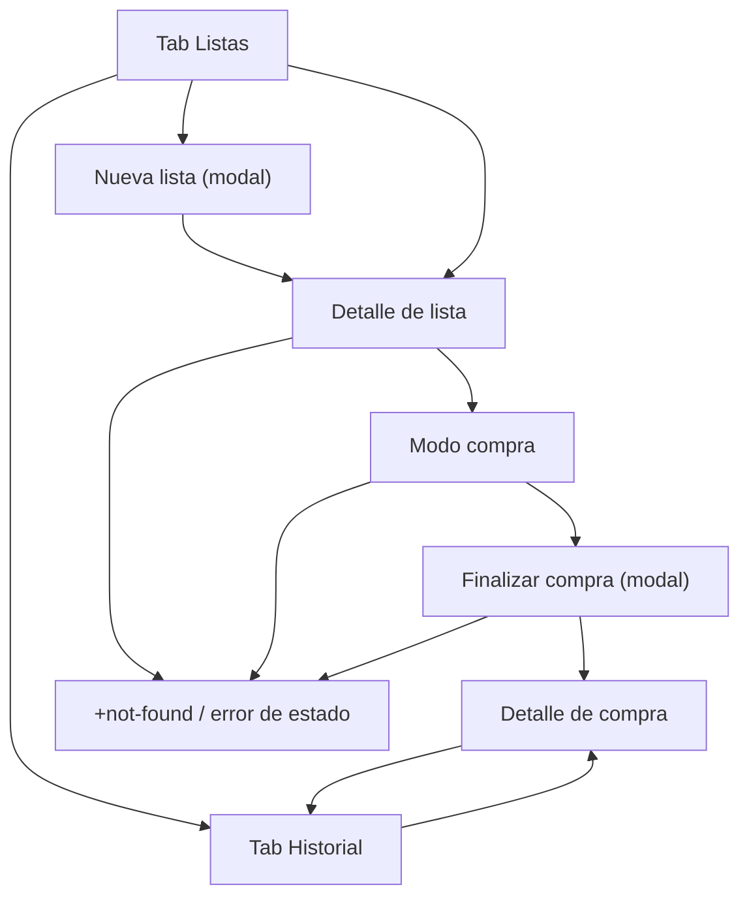

# 04 — Navegación y UX/UI

## 1. Principios de experiencia

1. **Una mano, pulgar primero.** Las acciones principales viven en la mitad inferior de la pantalla.
2. **Un toque por acción.** Marcar un artículo no abre un menú; se toca la fila.
3. **Siempre se sabe qué falta.** El progreso “7 de 12” está visible en modo compra.
4. **Nada se pierde por navegar.** Volver atrás no cancela la compra; los checks están en SQLite.
5. **Sin sorpresas.** Finalizar, cancelar y borrar explican el resultado antes de ejecutarlo.
6. **La prisa manda.** Textos cortos, objetivos grandes, sin pasos intermedios innecesarios.
7. **Accesible desde el inicio.** Roles, etiquetas, contraste y escala de texto no son un extra.

## 2. Journey map

| Etapa | Qué hace el usuario | Qué piensa / siente | Dolor | Respuesta de Listapp |
|---|---|---|---|---|
| **Necesidad** | Abre la app porque tiene que comprar. | “No quiero olvidarme de nada.” | Listas en papel o notas dispersas. | Portada clara con “Nueva lista” y compra activa. |
| **Preparación** | Crea la lista y añade artículos. | “Voy apuntando lo que falta.” | Añadir uno a uno es lento. | Campo siempre visible, autofoco y teclado que no tapa. |
| **Compra** | Llega al supermercado y empieza. | “Voy con prisa, una mano ocupada.” | Marcar es incómodo; no sabe qué falta. | Modo compra a pantalla completa, filas de 56 dp, progreso. |
| **Cierre** | Finaliza y elige supermercado. | “¿Se habrá guardado?” | No recuerda dónde ni cuándo compró. | Modal de finalización con resumen, supermercado y confirmación. |
| **Recuerdo** | Consulta el historial. | “¿Cuánto compré? ¿Dónde?” | El historial se mezcla con pendientes. | Tab Historial separada, fecha completa y supermercado. |

## 3. Mapa de navegación



## 4. Rutas y guardas

| Ruta | Archivo | Pantalla | Presentación | Guarda |
|---|---|---|---|---|
| `/` | `app/(tabs)/index.tsx` | Listas | Tab | Ninguna; espera a `boot()`. |
| `/historial` | `app/(tabs)/historial.tsx` | Historial | Tab | Ninguna; espera a `boot()`. |
| `/lista/nueva` | `app/lista/nueva.tsx` | Nueva lista | Modal | Ninguna. |
| `/lista/[id]` | `app/lista/[id]/index.tsx` | Detalle/edición | Stack | Existe; `draft` o `shopping`. Si `completed` → `/compra/[id]`. Si no existe → `+not-found`. |
| `/lista/[id]/comprar` | `app/lista/[id]/comprar.tsx` | Modo compra | Stack, pantalla completa | Solo `shopping`. `draft` → `/lista/[id]`; `completed` → `/compra/[id]`; no existe → `+not-found`. |
| `/lista/[id]/finalizar` | `app/lista/[id]/finalizar.tsx` | Finalizar compra | Modal | Solo `shopping`. `draft` → `/lista/[id]`; `completed` → `/compra/[id]`; no existe → `+not-found`. |
| `/compra/[id]` | `app/compra/[id].tsx` | Detalle de compra | Stack | Solo `completed`. `draft` → `/lista/[id]`; `shopping` → `/lista/[id]/comprar`; no existe → `+not-found`. |
| `*` | `app/+not-found.tsx` | No encontrado | Stack | — |

### 4.1 Reglas de navegación

- Todas las pantallas esperan a que `boot()` termine antes de leer.
- Cada pantalla carga la entidad antes de renderizar contenido; mientras tanto muestra un estado de carga, no una pantalla vacía.
- Las redirecciones usan `replace`, no `push`, para no dejar rutas inválidas en el historial.
- Tras finalizar: se resetea el stack a Historial y se abre el detalle de la compra. “Atrás” vuelve al Historial, no al modo compra.
- El botón atrás de Android en modo compra vuelve al detalle; **no cancela** la compra.
- El modal de finalizar se puede cerrar sin finalizar; no se escribe nada hasta confirmar.
- Mientras `isFinishing` está activo, se bloquean el botón de finalizar, el gesto de cierre, el botón atrás y el cierre del modal.
- Los deep links no son una función de producto, pero están guardados: una ruta con estado incorrecto redirige sin crash.

### 4.2 Grafo de estados de ruta

```text
/lista/[id]
  ├─ draft / shopping → renderiza detalle
  ├─ completed        → replace /compra/[id]
  └─ no existe        → replace /+not-found

/lista/[id]/comprar
  ├─ shopping         → renderiza modo compra
  ├─ draft            → replace /lista/[id]
  ├─ completed        → replace /compra/[id]
  └─ no existe        → replace /+not-found

/lista/[id]/finalizar
  ├─ shopping         → renderiza modal
  ├─ draft            → replace /lista/[id]
  ├─ completed        → replace /compra/[id]
  └─ no existe        → replace /+not-found

/compra/[id]
  ├─ completed        → renderiza detalle histórico
  ├─ draft            → replace /lista/[id]
  ├─ shopping         → replace /lista/[id]/comprar
  └─ no existe        → replace /+not-found
```

No hay ciclos: cada ruta tiene un destino canónico único para cada estado.

## 5. Pantallas

### 5.1 Listas (portada)

**Objetivo:** empezar una lista nueva o continuar la compra en curso.

- Wordmark “Listapp” y título “Listas”.
- Si hay compra activa: tarjeta verde destacada con:
  - nombre de la lista;
  - progreso “7 de 12”;
  - botón “Continuar compra”.
- Debajo, borradores con nombre, número de artículos y fecha de actualización.
- FAB “Nueva lista” en la esquina inferior derecha.
- Estado vacío: icono de cesta, “Aún no hay listas”, texto breve y CTA “Crear mi primera lista”.
- No muestra compras completadas; esas viven en Historial.
- Si hay una compra activa y se intenta empezar otra, se explica el conflicto y se ofrece continuar la existente.

**Orden:** compra activa primero; borradores por `updated_at` descendente.

### 5.2 Nueva lista (modal)

- Campo “Nombre de la lista” con autofoco.
- Placeholder: “Ej. Compra semanal”.
- Botón “Crear” deshabilitado si el nombre está vacío o solo tiene espacios.
- Al crear: cierra el modal y abre el detalle de la lista.
- “Cancelar” cierra sin crear.
- Error inline si el nombre supera 80 caracteres.

### 5.3 Detalle de lista

**Objetivo:** preparar la lista y empezar la compra.

- Cabecera con volver, nombre editable y menú:
  - “Renombrar” (edición inline; solo `draft`/`shopping`);
  - “Eliminar lista” con confirmación.
- Badge de estado: “Borrador” o “En compra”.
- Lista de artículos con:
  - nombre;
  - edición inline al tocar el nombre (en `draft`/`shopping`);
  - botón de eliminar con “Deshacer”;
  - sin checkboxes en `draft` (marcar solo tiene sentido en compra).
- Campo “Añadir artículo” siempre visible al final, con botón de añadir.
- Botón principal fijo:
  - “Empezar compra” si es `draft` y hay artículos;
  - “Continuar compra” si es `shopping`;
  - deshabilitado con ayuda contextual si no hay artículos.
- Si está en compra, aviso: “El progreso se guarda automáticamente”.
- Si la lista está vacía: estado vacío “Añade tu primer artículo”.

### 5.4 Modo compra

**Objetivo:** marcar rápido y saber qué falta.

- Pantalla completa, sin tabs.
- Cabecera: “Compra”, nombre de la lista y menú “Cancelar compra”.
- Barra de progreso grande:
  - “7 de 12”;
  - porcentaje;
  - valor accesible.
- Filas grandes de 56 dp:
  - checkbox de 28 dp;
  - nombre del artículo;
  - al marcar: check blanco sobre verde, texto tachado y atenuado;
  - al desmarcar: vuelve al estado normal.
- Las filas **no se mueven** al marcarse; se evita un salto bajo el pulgar.
- Campo “Añadir artículo” al final, con teclado que no tapa la lista.
- Botón inferior fijo “Finalizar compra”.
- “Cancelar compra” pide confirmación y avisa de que se desmarcarán todos los artículos y la lista volverá a borrador.
- Volver atrás no cancela; la compra sigue activa.
- No se puede borrar el último artículo en modo compra; para vaciar, se cancela y se edita el borrador.
- Háptico ligero al marcar/desmarcar.
- Si la lista queda sin artículos por una acción externa, se muestra un estado vacío y “Finalizar” se deshabilita.

### 5.5 Finalizar compra (modal)

**Objetivo:** cerrar la compra con el supermercado y la fecha.

- Resumen: “8 comprados · 2 sin comprar”.
- Campo “Supermercado”:
  - obligatorio;
  - `trim` y máximo 80;
  - chips con las últimas 8 compras para rellenar con un toque.
- Aviso si hay artículos sin comprar: “Se guardarán como no comprados”.
- Si hay 0 marcados:
  - aviso destacado “No has marcado ningún artículo”;
  - al pulsar “Finalizar”, confirmación: “Se guardará la compra con 0 comprados. ¿Continuar?”.
- Botón “Finalizar compra”:
  - deshabilitado sin supermercado;
  - deshabilitado mientras `isFinishing`;
  - spinner en el botón durante la transacción.
- Si falla: se queda en el modal, mensaje “No se pudo guardar. Reintenta” y opción de reintentar.
- Si la lista ya estaba completada (doble toque o carrera): se trata como éxito y se navega al detalle.
- Al confirmar: háptico de éxito y anuncio accesible “Compra guardada”.

### 5.6 Historial

**Objetivo:** recordar compras pasadas.

- Título “Historial”.
- `SectionList` agrupada por mes: “octubre 2026”.
- Fila:
  - “27 oct 2026 · 18:42”;
  - supermercado;
  - “8 de 10 comprados”;
  - chevron.
- Orden: `completed_at_utc` descendente.
- Sin paginación en el MVP; se cargan todas las compras completadas.
- Estado vacío: “Todavía no has finalizado ninguna compra”, con CTA a Listas.
- No muestra borradores ni compras activas.

### 5.7 Detalle de compra

**Objetivo:** consultar qué se compró y qué no.

- Cabecera: supermercado y fecha completa:
  - “martes, 27 de octubre de 2026, 18:42”.
- Resumen: “8 comprados · 2 sin comprar”.
- Sección “Comprados”: artículos marcados, con check.
- Sección “Sin comprar”: artículos no marcados, atenuados.
- Solo lectura: no se puede editar, marcar ni renombrar.
- Menú “Eliminar compra” con confirmación.
- Si la compra no existe: `+not-found`.

### 5.8 No encontrado

- “Esta lista no existe o se ha eliminado”.
- Botón “Volver a Listas”.
- No muestra una pantalla vacía ni un error técnico.

### 5.9 Errores de base de datos y versión

- **Error de arranque:** “No se pudo abrir la base de datos”, explicación breve y “Reintentar”.
- **Versión no compatible:** “Versión no compatible”, versión detectada y requerida, instrucciones para instalar el APK más reciente (`adb install -r`). Sin botón muerto de “Actualizar”.
- **Base de datos bloqueada:** “Cierra la app desde el selector de aplicaciones y vuelve a abrirla”. No se borra la BD.
- Estas pantallas son bloqueantes: no se muestra la app a medias.

## 6. Sistema de diseño

### 6.1 Identidad

- **Nombre:** “Listapp”, una palabra, L mayúscula.
- **Color:** verde funcional sobre blanco. El verde indica acción principal, progreso y compra activa; el blanco es el fondo dominante.
- **Tono:** cercano, directo, sin exclamaciones ni tecnicismos.
- **Estilo:** superficies blancas, bordes finos, esquinas moderadas, sin gradientes ni glassmorphism. La jerarquía se construye con tamaño, peso y espacio.
- **Icono:** cesta blanca con check sobre fondo verde `#15803D`; icono adaptativo con zona segura y versión monocroma.
- **Splash:** fondo verde, logo blanco; se oculta cuando `boot()` termina, sin retardo artificial.

### 6.2 Tokens de color

| Token | Hex | Uso | Contraste |
|---|---|---|---|
| `brand.50` | `#F0FDF4` | Fondo teñido suave | — |
| `brand.100` | `#DCFCE7` | Tarjetas/estados verdes claros | Texto `brand.800` |
| `brand.600` | `#15803D` | Primario, tabs activas, check, progreso | **5,0:1** sobre blanco; blanco encima **5,0:1** |
| `brand.700` | `#166534` | Primario pulsado | **7,2:1** sobre blanco |
| `brand.800` | `#14532D` | Texto verde sobre fondos claros | >8:1 sobre `brand.100` |
| `neutral.0` | `#FFFFFF` | Fondo y superficie | — |
| `neutral.50` | `#F8FAFC` | Fondo alternativo | — |
| `neutral.100` | `#F1F5F9` | Relleno de inputs deshabilitados | — |
| `neutral.200` | `#E2E8F0` | Divisores y bordes decorativos | No usar para identificar controles |
| `neutral.500` | `#64748B` | Texto secundario, placeholder | **4,76:1** sobre blanco |
| `neutral.600` | `#475569` | Texto secundario fuerte | **7,6:1** sobre blanco |
| `neutral.900` | `#0F172A` | Texto principal | **17,9:1** sobre blanco |
| `danger.600` | `#B91C1C` | Errores y eliminar | **6,5:1** sobre blanco |
| `danger.50` | `#FEF2F2` | Fondo de error | — |
| `warning.600` | `#B45309` | Avisos | **5,0:1** sobre blanco |

**Aliases semánticos:**

| Alias | Token |
|---|---|
| `bg` | `neutral.0` |
| `bgSubtle` | `brand.50` |
| `surface` | `neutral.0` |
| `text` | `neutral.900` |
| `textSecondary` | `neutral.600` |
| `textMuted` | `neutral.500` |
| `border` | `neutral.200` |
| `controlBorder` | `neutral.500` |
| `primary` | `brand.600` |
| `primaryPressed` | `brand.700` |
| `onPrimary` | `neutral.0` |
| `primarySoft` | `brand.100` |
| `focus` | `brand.600` |
| `danger` | `danger.600` |

**Reglas de contraste:**

- `brand.600` cumple AA como texto normal sobre blanco y como fondo con texto blanco.
- No usar `brand.600` para texto pequeño sobre `brand.100`; ahí va `brand.800`.
- `neutral.500` cumple sobre blanco, pero no sobre `neutral.100`; para texto pequeño sobre gris claro usar `neutral.600`.
- `neutral.400` no se usa como borde de control: no llega a 3:1.
- Los bordes de inputs y checkboxes usan `controlBorder` (`neutral.500`), no `neutral.200`.
- El color nunca es la única señal: check + tachado + texto “Comprado”.
- Los ratios son cálculos WCAG; se validarán con una herramienta antes de congelar los tokens.

### 6.3 Tipografía

Fuente del sistema: Roboto en Android, San Francisco en iOS. Sin carga de fuentes.

| Estilo | Tamaño / línea | Peso | Uso |
|---|---|---|---|
| `display` | 32 / 38 | 700 | Cifras grandes de progreso. |
| `h1` | 28 / 34 | 700 | Título de pantalla. |
| `h2` | 22 / 28 | 600 | Sección / nombre de lista. |
| `title` | 18 / 24 | 600 | Nombre de artículo destacado. |
| `body` | 16 / 24 | 400 | Texto general. |
| `bodyStrong` | 16 / 24 | 600 | Supermercado, totales. |
| `label` | 14 / 20 | 500 | Etiquetas de campo, tabs. |
| `caption` | 12 / 16 | 400 | Fecha, metadatos. |
| `button` | 16 / 20 | 600 | Botones. |

- `allowFontScaling` activo; no se limita el texto del cuerpo.
- No se fijan alturas de contenedores; los botones usan `minHeight`, no `height`.
- Números de progreso con `fontVariant: ['tabular-nums']`.
- Nombres de artículos: permitir 2–3 líneas y que la fila crezca; no truncar.
- Los metadatos pueden usar 12, pero nunca para acciones o información esencial.

### 6.4 Espaciado, radios y elevación

| Token | Valor |
|---|---|
| `space.1` | 4 |
| `space.2` | 8 |
| `space.3` | 12 |
| `space.4` | 16 |
| `space.5` | 20 |
| `space.6` | 24 |
| `space.8` | 32 |
| `space.10` | 40 |
| `space.12` | 48 |

- Margen horizontal de pantalla: 16.
- Separación entre secciones: 24.
- Padding de tarjeta: 16.
- Fila de artículo: mínimo 56 de alto, 14 vertical.
- Radio: 8 inputs, 12 tarjetas/botones, 16 modales, 999 pills/FAB.
- Bordes de 1; foco de 2 con offset 2.
- Elevación: solo FAB y modales; tarjetas con borde, sin sombras pesadas.

### 6.5 Componentes base

| Componente | Especificación |
|---|---|
| `Screen` | Safe area, fondo blanco, padding horizontal 16. |
| `PrimaryButton` | Fondo `brand.600`, texto blanco, altura mínima 52, radio 12; pulsado `brand.700`; deshabilitado `neutral.200` con texto `neutral.600`. |
| `SecondaryButton` | Fondo blanco, borde 1,5 `brand.600`, texto `brand.600`. |
| `IconButton` | 48×48, icono 24, etiqueta accesible obligatoria. |
| `TextField` | Etiqueta visible arriba, borde `controlBorder`, altura mínima 48, error con icono + texto. |
| `CheckboxRow` | Fila completa de 56, círculo de 28, check blanco sobre verde, texto tachado y `neutral.600` al marcar. |
| `ProgressBar` | Altura 8, track `brand.100`, fill `brand.600`, etiqueta “7 de 12” y porcentaje accesible. |
| `ListCard` | Nombre, número de artículos, badge de estado; borde `neutral.200`. |
| `ItemRow` | Nombre, edición inline, eliminar; memorizado. |
| `PurchaseRow` | Fecha completa, supermercado, “8 de 10 comprados”, chevron. |
| `EmptyState` | Icono, título, explicación y CTA. |
| `Snackbar` | Errores no bloqueantes y “Deshacer”; `accessibilityLiveRegion="polite"`. |
| `SupermarketInput` | Campo + chips de sugerencias. |

**Confirmaciones destructivas:** `Alert.alert` nativo, accesible y sin dependencia extra. No hay bottom sheets propios ni librería de modales.

### 6.6 Movimiento

| Interacción | Movimiento |
|---|---|
| Pulsar botón/fila | Escala 0,98 y opacidad 0,9; 100 ms. |
| Marcar artículo | Check con spring suave, 180 ms; háptico ligero. |
| Progreso | Relleno con `scaleX` y timing 200 ms. |
| Añadir/eliminar | Sin animación de altura; aparición/desaparición inmediata. |
| Navegación | Transiciones nativas del stack; modal slide. |
| Finalizar | Háptico de éxito; sin confeti ni animación larga. |

- Solo `transform` y `opacity`; no se animan `width`, `height` ni `top`.
- Nada de animaciones continuas, parallax ni scroll hijacking.
- “Reducir movimiento” desactiva springs y transiciones decorativas; el cambio de estado sigue siendo instantáneo.
- Se usa `Animated` de React Native con `useNativeDriver` cuando la propiedad lo permite.

## 7. Accesibilidad

### 7.1 Requisitos

- Objetivo táctil mínimo **48 × 48 dp**; filas de 56.
- Etiquetas visibles en todos los campos; el placeholder no sustituye a la etiqueta.
- `CheckboxRow`:
  - `accessibilityRole="checkbox"`;
  - `accessibilityState={{ checked }}`;
  - etiqueta “Leche, comprado” / “Leche, no comprado”;
  - pista “Toca para cambiar”.
- `ProgressBar`:
  - `accessibilityRole="progressbar"`;
  - `accessibilityValue` con mínimo, máximo y actual.
- Cabeceras con `accessibilityRole="header"`.
- Iconos decorativos con `accessible={false}`.
- Confirmaciones con botones destructivos claros; no se usa solo el color rojo.
- Al finalizar: anuncio con `AccessibilityInfo.announceForAccessibility`.
- Foco inicial en el campo de nombre al abrir “Nueva lista”; foco al primer error de validación.
- Errores de formulario anunciados; no solo borde rojo.
- Probado con TalkBack y con escala de fuente al 200 %.
- “Reducir movimiento” respetado mediante `AccessibilityInfo.isReduceMotionEnabled`.
- Modo claro con contraste AA; no se promete modo oscuro.

### 7.2 Checklist manual

- [ ] Todo control es alcanzable y activable con TalkBack.
- [ ] El estado “comprado/no comprado” se anuncia al cambiar.
- [ ] El progreso se anuncia con un valor comprensible.
- [ ] Los botones tienen etiqueta, no solo icono.
- [ ] El texto al 200 % no recorta nombres ni botones.
- [ ] Los objetivos táctiles miden al menos 48 dp.
- [ ] El foco es visible y sigue un orden lógico.
- [ ] “Reducir movimiento” desactiva animaciones decorativas.
- [ ] Los mensajes de error se leen y no dependen del color.
- [ ] Las confirmaciones destructivas se pueden cancelar.

## 8. Microcopy

| Contexto | Texto |
|---|---|
| Tabs | “Listas”, “Historial” |
| Portada | “Listas”, “Continuar compra”, “Nueva lista” |
| Vacío de listas | “Aún no hay listas”, “Crea una para empezar tu próxima compra.”, “Crear mi primera lista” |
| Nueva lista | “Nombre de la lista”, “Ej. Compra semanal”, “Crear” |
| Detalle | “Borrador”, “En compra”, “Añadir artículo”, “Empezar compra”, “Continuar compra” |
| Compra | “Compra”, “7 de 12”, “Finalizar compra”, “Cancelar compra” |
| Cancelar | “Se desmarcarán todos los artículos y la lista volverá a borrador. ¿Cancelar la compra?” |
| Finalizar | “Supermercado”, “¿Dónde has comprado?”, “8 comprados · 2 sin comprar”, “Se guardarán como no comprados” |
| Cero marcados | “No has marcado ningún artículo. Se guardará la compra con 0 comprados. ¿Continuar?” |
| Historial | “Historial”, “Todavía no has finalizado ninguna compra” |
| Detalle histórico | “Comprados”, “Sin comprar”, “Eliminar compra” |
| Borrado de artículo | “Artículo eliminado”, “Deshacer” |
| Error de guardado | “No se pudo guardar. Reintenta.” |
| Error de arranque | “No se pudo abrir la base de datos.”, “Reintentar” |
| Versión | “Versión no compatible”, “Instala el APK más reciente.” |
| BD bloqueada | “Cierra la app desde el selector de aplicaciones y vuelve a abrirla.” |
| No encontrado | “Esta lista no existe o se ha eliminado.”, “Volver a Listas” |

**Tono:** frases cortas, verbos en imperativo, sin signos de exclamación, sin “por favor” repetido. Se tutea.

## 9. Estados de carga, vacío y error

| Estado | Qué se muestra |
|---|---|
| Arranque | Splash nativo; sin pantalla en blanco. |
| Carga de pantalla | Indicador discreto o skeleton; nunca una lista vacía que parezca real. |
| Lista sin artículos | Icono, “Añade tu primer artículo”, campo de añadir. |
| Historial vacío | Icono, “Todavía no has finalizado ninguna compra”, CTA a Listas. |
| Compra sin marcados | Progreso 0 de N; el botón Finalizar sigue disponible con confirmación. |
| Error de escritura | Snackbar; la UI no cambia; se puede reintentar. |
| Error de BD | Pantalla bloqueante con instrucciones; no se borra la BD. |
| Ruta inválida | Redirección segura o `+not-found`. |

## 10. Teclado, safe areas y pantallas

- Edge-to-edge con `react-native-safe-area-context`.
- El botón inferior fijo respeta el inset inferior.
- `KeyboardAvoidingView` en detalle y compra; `keyboardShouldPersistTaps="handled"`.
- El campo de añadir no queda tapado por el teclado.
- Orientación vertical; no se optimiza landscape ni tablet.
- En pantallas pequeñas, el contenido scrollea; los botones principales no se solapan con el teclado.
- El header nativo usa el safe area superior.

## 11. Decisiones de diseño

| Decisión | Elección |
|---|---|
| Tema | Claro; verde y blanco. Sin modo oscuro en el MVP. |
| Fuente | Sistema; sin fuentes custom. |
| Iconos | Ionicons de `@expo/vector-icons`. |
| Animación | `Animated` de RN; sin Reanimated. |
| Tarjetas | Borde fino, sin sombras pesadas. |
| Gradientes/glass | No. |
| Confirmaciones | `Alert.alert` nativo. |
| Formularios | Inputs controlados + validadores puros; sin React Hook Form/Zod. |
| Fecha | Formateador propio en español; sin `Intl` en la UI. |
| Historial | `SectionList` por mes; sin paginación. |
